#  Hi, Welcome back 

<div style="margin-top: 20px;">

<!-- 


 -->


<!-- _កម្មករសរសេរកូដ_ 😂 _(Vibe Coder • Vibe Designer)_ -->

I am a Senior Front-End Developer at _TURBOTECH CO,.LTD_ also as a Open Source _Vibe (Coder/Designer)_ with a huge love for Node.js, Next.js, Nuxt.js, PostgreSQL, REST API and Data Visualization.

- 🌱 I'm currently learning many things, I believe that everyday is a learning opportunity.
- 🧑‍💻 Passionate about coding and open source projects
- 🎨 Lover of design and user experience
- 💖 Explorer of new technologies and frameworks
- 💻 Visit my [Portfolio](https://pphat.me) for more details about me.

## 🍳 Most used tech stacks

<br>
<div>


</div>

## 🥗 Most tech stack used yesterday

<div align="left">

<!--START_SECTION:daily-->
```diff
████████░░░░░░░░░░░░░░░░░ ⁝ 32.22% • HTML
████████░░░░░░░░░░░░░░░░░ ⁝ 31.99% • TypeScript
███░░░░░░░░░░░░░░░░░░░░░░ ⁝ 12.44% • JSON
██░░░░░░░░░░░░░░░░░░░░░░░ ⁝ 8.32% • Markdown
█░░░░░░░░░░░░░░░░░░░░░░░░ ⁝ 5.15% • YAML
█░░░░░░░░░░░░░░░░░░░░░░░░ ⁝ 2.34% • CSV
█░░░░░░░░░░░░░░░░░░░░░░░░ ⁝ 2.05% • Bash
░░░░░░░░░░░░░░░░░░░░░░░░░ ⁝ 1.15% • Git Config
░░░░░░░░░░░░░░░░░░░░░░░░░ ⁝ 0.66% • CSS
░░░░░░░░░░░░░░░░░░░░░░░░░ ⁝ 0.65% • Git
░░░░░░░░░░░░░░░░░░░░░░░░░ ⁝ 0.5% • Image (png)
░░░░░░░░░░░░░░░░░░░░░░░░░ ⁝ 0.47% • Other
░░░░░░░░░░░░░░░░░░░░░░░░░ ⁝ 0.43% • Text
░░░░░░░░░░░░░░░░░░░░░░░░░ ⁝ 0.41% • TSConfig
░░░░░░░░░░░░░░░░░░░░░░░░░ ⁝ 0.37% • JavaScript
░░░░░░░░░░░░░░░░░░░░░░░░░ ⁝ 0.3% • PHP
░░░░░░░░░░░░░░░░░░░░░░░░░ ⁝ 0.25% • Image (jpeg)
░░░░░░░░░░░░░░░░░░░░░░░░░ ⁝ 0.19% • Image (svg)
░░░░░░░░░░░░░░░░░░░░░░░░░ ⁝ 0.06% • TOML
░░░░░░░░░░░░░░░░░░░░░░░░░ ⁝ 0.05% • Batchfile
░░░░░░░░░░░░░░░░░░░░░░░░░ ⁝ 0.01% • XML
```
<!--END_SECTION:daily-->

</div>

## 🌟 Daily commitment



<br>

## 🧪 Most coding language 




## ✨ Hello new friends

<div>
<!--START_SECTION:followers-->
<a href="https://github.com/t99197702-rgb"></a>
<a href="https://github.com/Sopheak-HUN"></a>
<a href="https://github.com/vitou18"></a>
<a href="https://github.com/the-d3fender"></a>
<a href="https://github.com/Chhoranndorn"></a>
<a href="https://github.com/RongMarin99"></a>
<a href="https://github.com/ahmadrizal-baihaqi"></a>
<a href="https://github.com/duncuo164"></a>
<a href="https://github.com/cachewraith"></a>
<a href="https://github.com/Dvurechensky"></a>
<!--END_SECTION:followers-->
</div>

<br>

